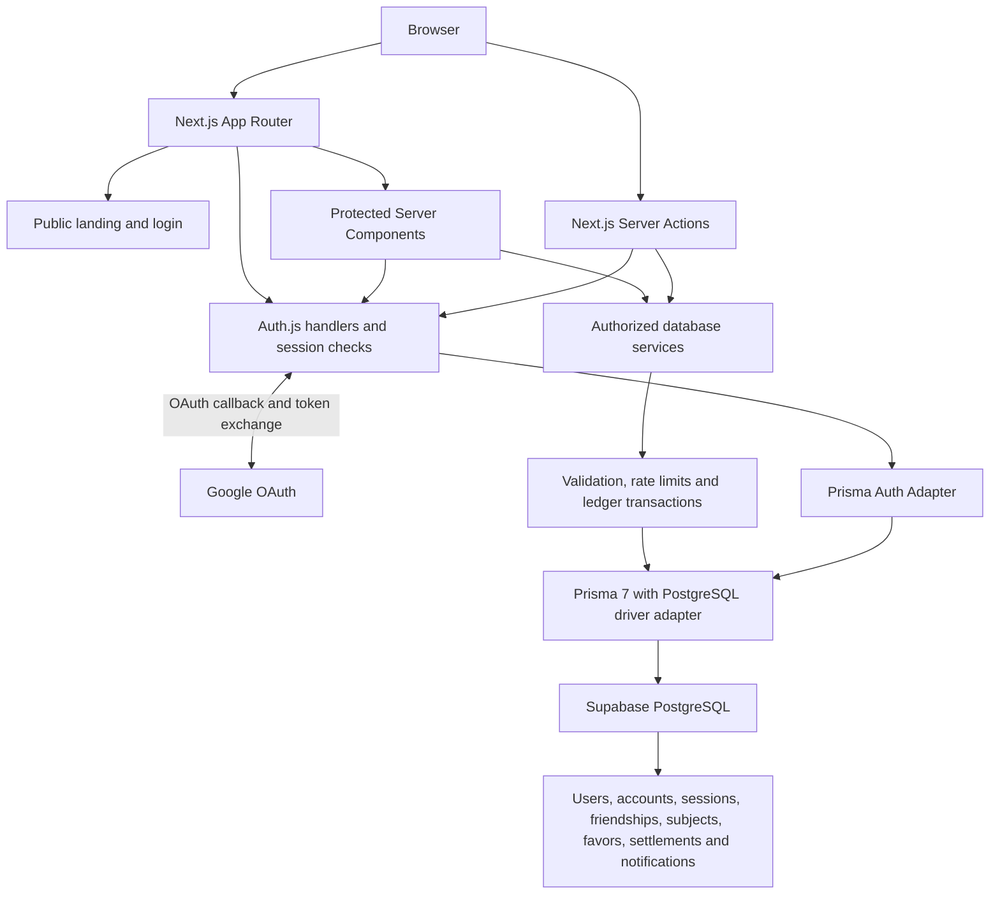

<div align="center">

# Proxy Ledger

**Good friends. Clear balances.**

A shared ledger for attendance favors: record what happened, confirm it together, and keep track of who owes whom.


[Live Demo](https://proxyledger.vercel.app) · [Features](#features) · [Getting Started](#getting-started) · [Architecture](#architecture)

</div>

---

## Overview

Informal favors are easy to forget and awkward to reconcile. Proxy Ledger gives friends a shared record of attendance favors and repayments, with confirmation from both sides before a record affects the balance.

Subjects organize the history; balances stay global across subjects for each pair of friends. The application combines a public animated landing page with an authenticated workspace backed by PostgreSQL. Dashboard statistics, transaction history, and settlements use database records rather than demo counters.

## Live demo

[Open Proxy Ledger →](https://proxyledger.vercel.app)

Sign in with Google to access your workspace. To explore the complete invitation, favor, and settlement flow, use two consenting Google accounts. Records created in the live application are real records; use an isolated local database for automated testing.

## Screenshots

Public, anonymized product screenshots have not been supplied. The existing verification capture in `docs/` contains identifiable ledger information and is intentionally omitted here.

| Preview | Recommended asset — not yet supplied |
| --- | --- |
| Landing page | `docs/screenshots/landing.png` |
| Dashboard overview | `docs/screenshots/dashboard.png` |
| Friends and invitations | `docs/screenshots/friends.png` |
| Global balances and shared history | `docs/screenshots/balances.png` |
| Settlement confirmation | `docs/screenshots/settlements.png` |

Capture these with synthetic demo identities, and remove personal names, emails, photos, and private notes before publishing. These are planned filenames, not image links. A standalone verified Proxy Ledger logo asset is also not included.

## Features

- **Google authentication:** automatic first-login account creation, database-backed sessions, authenticated profile display, and sign-out.
- **Friends and invitations:** registered-user discovery, incoming/outgoing invitations, acceptance, rejection, cancellation, and removal.
- **Attendance favors:** record a provided or received favor, select a private subject, and optionally add a date and note. The other participant confirms or rejects it; the creator can cancel a pending request.
- **Global balances:** see what each friend owes you or what you owe them, across every subject, with shared ledger history.
- **Two-party settlements:** propose a whole-number repayment and require confirmation from the other participant before reducing debt.
- **Private subjects and search:** create subjects and search records available to your authenticated workspace.
- **Notifications:** invitation, favor, and settlement updates with read state and links to the relevant record. The UI refreshes periodically and on focus; this is not a push-notification service.
- **Integrated dashboard:** database-backed summaries, transaction and settlement details, pagination, empty states, and retry feedback.
- **Responsive interface:** animated landing page, mobile navigation, modal forms, avatar fallbacks, and reduced-motion handling.
- **Account settings:** view the Google-linked profile and sign out. Profile editing and account deletion are not implemented.

## Technology stack

| Layer | Technologies |
| --- | --- |
| Frontend | Next.js 16 App Router, React 19, TypeScript |
| Backend | Next.js Server Components and Server Actions, Zod validation, server-only services |
| Database and ORM | Supabase PostgreSQL, Prisma 7, `@prisma/adapter-pg`, `pg`, reviewed SQL migrations |
| Authentication | Auth.js v5 / NextAuth beta, Google OAuth, Prisma Adapter, database sessions |
| Styling and UI | Tailwind CSS 4, Base UI, Lucide icons, class-variance-authority, clsx, tailwind-merge |
| Animation | GSAP with `@gsap/react`, Motion for React |
| Deployment | Vercel, Vercel Analytics, Node.js 24 |
| Testing and tooling | Vitest, Playwright, axe-core, ESLint, tsx, pnpm 11.18.0 |

Supabase hosts PostgreSQL; authentication is handled by Auth.js, not Supabase Auth. There is no second user store.

## Architecture



The browser receives rendered views and allowed profile fields. Credentials, database access, and OAuth provider tokens remain on the server. Protected actions derive the actor from the server session and apply participant or owner checks before accessing records.

### Routes and server actions

| Route | Purpose |
| --- | --- |
| `/` | Public landing page |
| `/login` | Google sign-in and authentication feedback |
| `/dashboard` | Authenticated overview |
| `/dashboard/friends`, `/dashboard/friends/[id]` | Invitations, friends, and friend details |
| `/dashboard/transactions`, `/dashboard/transactions/[id]` | Favor history and confirmation details |
| `/dashboard/subjects` | Private subjects |
| `/dashboard/balances`, `/dashboard/balances/[friendId]` | Global pair balances and ledger history |
| `/dashboard/settlements`, `/dashboard/settlements/[id]` | Settlement requests and details |
| `/dashboard/notifications` | Notification inbox |
| `/dashboard/settings` | Google profile and sign-out |
| `/api/auth/[...nextauth]` | Auth.js GET/POST handlers, including Google callback and session endpoints |

Business mutations use Server Actions rather than a separate public REST API. Their implementations are in the dashboard `actions.ts` files; database services live in `lib/`. Dashboard routes require a server-side session, and signed-in visitors to `/login` return to `/dashboard`.

## How it works

1. Sign in with Google and invite another registered user.
2. Accept the invitation to establish the friendship.
3. Record a favor against a subject and send it for confirmation.
4. The other participant confirms or rejects the request.
5. Review the global balance and shared event history.
6. Propose a settlement; the other participant confirms it to reduce the debt.

### Accounting example

Alice performs two favors for Bob, and Bob confirms both. Alice sees **+2** against Bob; Bob sees **−2** against Alice. If Bob later performs one confirmed favor for Alice in a different subject, those balances become **+1** and **−1**. A confirmed settlement of one unit then brings both to zero.

- Every confirmed favor is **one unit**, not a currency amount.
- The performer is the creditor; the recipient is the debtor.
- Positive means the friend owes you; negative means you owe the friend.
- Balances are bilateral and global across subjects. Debts between different friends are not automatically offset.
- Pending, rejected, canceled, and reversed favors contribute nothing. Only confirmed settlements adjust the balance.
- Removing a friendship preserves historical records and allows existing debt to be settled; recording new favors requires an accepted friendship.

See [Phase 5](docs/PHASE5.md) for settlement direction, pair locking, and ledger invariants.

## Getting started

### Prerequisites

- Node.js **24.x**.
- pnpm **11.18.0**, as declared in `package.json`.
- Git and a local PostgreSQL **15+** database, or a separate development Supabase project. The SQL ledger view uses PostgreSQL's `security_invoker` option.
- A Google OAuth **Web application** client for real sign-in.

Use a dedicated development database and a role allowed to apply migrations. The server-side runtime role must also have access to the tables protected by RLS; the Supabase table owner or a suitable backend role is required. A browser-facing anonymous key is not a database credential for this application.

### Clone and install

```sh
git clone https://github.com/yashvatsdev/proxyledger.git
cd proxyledger
npm install --global pnpm@11.18.0
pnpm install --frozen-lockfile
```

Create your local environment file:

**Windows PowerShell**

```powershell
Copy-Item .env.example .env
```

**Unix / macOS**

```sh
cp .env.example .env
```

Edit `.env` using the configuration below. If PowerShell blocks the package-manager shim, use `pnpm.cmd` in place of `pnpm`.

### Prepare the development database

Create an empty development database, then configure its runtime and migration URLs. Run:

```sh
pnpm db:validate
pnpm db:generate
pnpm db:deploy
pnpm dev
```

Open [localhost:3000](http://localhost:3000). `db:deploy` applies the existing migrations to the configured target; verify that target is development before running it. Installation and builds generate the Prisma client automatically, but do not apply migrations.

`pnpm db:seed` optionally adds repeatable demo data to a development database. It is not a substitute for Google OAuth setup. For intentional local schema changes, use `pnpm db:migrate --name descriptive_name` and review the SQL. Do not substitute `db push` for the custom SQL constraints, ledger view, and functions in the migration history.

### Common commands

| Command | Purpose |
| --- | --- |
| `pnpm dev` | Start the development server |
| `pnpm build` | Generate Prisma and create the production build |
| `pnpm start` | Serve an existing production build |
| `pnpm typecheck` | Check TypeScript; requires the generated Prisma client |
| `pnpm lint` | Run ESLint |
| `pnpm test` | Run Vitest; database suites are opt-in |
| `pnpm test:browser` | Run the isolated local browser release harness |
| `pnpm db:validate` | Validate Prisma configuration and schema |
| `pnpm db:generate` | Generate the Prisma client |
| `pnpm db:deploy` | Apply existing migrations to the configured database |
| `pnpm db:migrate --name descriptive_name` | Create/apply a development migration |
| `pnpm db:seed` | Add development demo data |
| `pnpm audit` | Review dependency advisories |

## Environment configuration

Use [.env.example](.env.example) as the template. Never commit `.env`, OAuth secrets, database credentials, or certificates, and never prefix credentials with `NEXT_PUBLIC_`.

| Variable | Requirement and purpose |
| --- | --- |
| `DATABASE_URL` | Required for authenticated runtime access. PostgreSQL connection URL; use the provider's pooled endpoint for serverless hosting. |
| `AUTH_SECRET` | Required for authentication. Cryptographically random secret of at least 32 characters. |
| `AUTH_GOOGLE_ID` | Required for Google login. OAuth Web application client ID. |
| `AUTH_GOOGLE_SECRET` | Required for Google login. Matching OAuth client secret. |
| `DIRECT_DATABASE_URL` | Optional CLI migration connection; otherwise Prisma falls back to `DATABASE_URL`. Configure a suitable direct/session endpoint when runtime uses a transaction pooler. |
| `DATABASE_SSL_CA` | Conditional runtime trust configuration when the provider's certificate chain is not trusted by Node. Expects **PEM contents, not a file path**; escaped `\n` is supported. |
| `AUTH_URL` | Optional canonical origin when automatic Auth.js origin detection is unsuitable. |
| `AUTH_TRUST_HOST` | Only for a trusted self-hosted proxy setup. Vercel infers trusted-host handling. |

Remote runtime connections enforce certificate-verified TLS. Download the CA through your provider's authenticated settings if needed and store its contents securely. Do not disable certificate verification to work around a connection failure. Prisma CLI migration connections need their own verified-TLS configuration; they do not use the runtime pool helper.

Generate `AUTH_SECRET` locally, then keep the generated value private:

```sh
node -e "console.log(require('node:crypto').randomBytes(32).toString('base64'))"
```

### Google OAuth setup

1. Configure the Google Cloud project's OAuth branding and audience. If the consent app is in testing, add your intended test accounts.
2. Create an OAuth client of type **Web application**.
3. Register the authorized origins `http://localhost:3000` and `https://proxyledger.vercel.app`, or your own deployed origin.
4. Register the exact redirect URIs:
   - `http://localhost:3000/api/auth/callback/google`
   - `https://proxyledger.vercel.app/api/auth/callback/google`
5. Set the matching client ID and secret, then restart the local server or deploy after configuring the target environment.

Use the exact scheme, host, port, and path. Separate development and production clients where practical. Additional local ports or preview domains need matching callbacks. Check Google's consent/publishing requirements before making your own deployment public.

## Project structure

```text
proxyledger/
├── app/
│   ├── api/auth/[...nextauth]/   # Auth.js HTTP handlers
│   ├── dashboard/               # Protected workspace pages and actions
│   ├── login/                   # Google sign-in UI and actions
│   ├── globals.css
│   └── page.tsx                 # Public landing page
├── components/                  # Shared dashboard and UI components
├── hooks/                       # Reduced-motion hook
├── lib/                         # Auth, validation, database and ledger services
├── prisma/
│   ├── migrations/              # Schema, constraints and ledger SQL
│   ├── schema.prisma
│   └── seed.ts
├── scripts/                     # Generation, diagnostics and browser checks
├── tests/                       # Unit, regression and opt-in PostgreSQL tests
├── docs/                        # Phase reports and operational runbooks
├── public/                      # Static assets
├── types/next-auth.d.ts          # Session type augmentation
├── auth.ts                      # Auth.js and Prisma Adapter configuration
├── prisma.config.ts             # Prisma CLI configuration
├── vercel.json                  # Explicit install and build commands
└── .env.example                 # Non-secret configuration template
```

The generated client lives in `generated/prisma/` after installation or generation and is not committed.

## Technical highlights

- **Database-backed accounting:** balances derive from confirmed events. SQL constraints and ledger guards complement application validation.
- **Concurrent confirmation handling:** transaction-scoped pair locks and authoritative balance checks prevent settlements from over-clearing the same debt. Guarded status transitions and submission keys handle duplicate requests.
- **Explicit authorization:** actions authenticate on the server, while services scope records to the actor's ownership or participation. Layout redirects are not the only access check.
- **Database sessions:** Auth.js uses the existing User, Account, and Session models. Sessions have a 30-day lifetime and daily update interval; provider tokens are not returned in the browser session payload.
- **Serverless-aware connections:** the Prisma PostgreSQL adapter uses one connection per Vercel instance and five locally. Transaction acquisition has a bounded 10-second wait, and dashboard reads are sequenced to avoid contention in the single-connection pool.
- **Distributed rate limiting:** atomic PostgreSQL buckets use database time and work across application instances without a separate Redis service.
- **Safe diagnostics:** authentication and operational logging use structured, restricted categories rather than raw errors, SQL, tokens, or personal data.

These are implementation choices, not a guarantee that deployment configuration or every possible security issue has been verified. See [the security audit](docs/PHASE7A.md), [OAuth diagnostics](docs/OAUTH_LOGIN_DIAGNOSTICS.md), and [dashboard database diagnostics](docs/DASHBOARD_DATABASE_DIAGNOSTICS.md).

## Testing

### Default checks

```sh
pnpm typecheck
pnpm lint
pnpm db:validate
pnpm test
pnpm build
```

Vitest covers ledger calculations, input validation, authentication handlers and redirects, action authorization, diagnostic sanitization, pool configuration, and dashboard read scheduling. The default run skips PostgreSQL integration suites; it does not prove real Google token exchange or production HTTPS behavior.

### PostgreSQL integration tests

Use a separate disposable database with the existing migrations applied. Set `TEST_DATABASE_URL`, `TEST_DATABASE_ISOLATED=1`, and the three opt-in switches:

**Windows PowerShell**

```powershell
$env:TEST_DATABASE_ISOLATED = '1'
$env:RUN_FRIENDS_DB_TESTS = '1'
$env:RUN_FAVORS_DB_TESTS = '1'
$env:RUN_LEDGER_DB_TESTS = '1'
pnpm test --no-file-parallelism --testTimeout=15000 --hookTimeout=20000
```

**Unix / macOS**

```sh
TEST_DATABASE_ISOLATED=1 RUN_FRIENDS_DB_TESTS=1 RUN_FAVORS_DB_TESTS=1 RUN_LEDGER_DB_TESTS=1 \
  pnpm test --no-file-parallelism --testTimeout=15000 --hookTimeout=20000
```

Supply `TEST_DATABASE_URL` privately before either command. When preparing the test schema, use a separate migration terminal targeting only the disposable database; restore the normal development URLs before running the suites. The test helper rejects a target matching the application or migration database and rejects production mode. Host aliases can still reach the same database, so verify actual isolation yourself.

These suites write and clean up fixtures. They cover unauthorized access, forged confirmations, duplicate requests, cross-subject accounting, settlement limits, and concurrency. Never run them against production or historical user data.

### Browser release checks

Install Chromium with `pnpm exec playwright install chromium`. `pnpm test:browser` expects a **separately started local production server**, normally at `http://localhost:3108`, and a disposable localhost PostgreSQL database. The fixture setup also needs the `anon` and `authenticated` roles used by the security checks.

In the server terminal, use process-local database variables targeting that disposable database, dummy Google credentials, a local test secret, `AUTH_URL=http://localhost:3108`, `AUTH_TRUST_HOST=true`, and `VERCEL=1` to exercise the one-connection pool. Run `pnpm build`, then `pnpm start --port 3108`. In the test terminal, keep normal application database variables separate and set the isolated test variables above. `RELEASE_TEST_ORIGIN` optionally changes the localhost port.

The harness provisions synthetic database sessions, exercises the two-account UI workflow, checks responsive layouts with Playwright and accessibility with axe, and cleans up its fixtures. Reports go to ignored `.phase7-artifacts/`. It does **not** contact Google. See [Phase 7C](docs/PHASE7C.md) for recorded release checks and remaining manual checks.

## Deployment and operational notes

The repository includes Vercel configuration for Next.js, frozen-lockfile installation with pnpm 11.18.0, and Prisma generation during the build. Configure Node.js 24 and separate Development, Preview, and Production database targets and secrets.

Before deploying your own instance:

1. Review [the deployment runbook](docs/DEPLOYMENT.md) and [isolated preview plan](docs/PREVIEW_DEPLOYMENT_PLAN.md).
2. Configure the target environment variables and exact Google callback for its domain.
3. Verify pooled database connectivity, certificate trust, and the migration connection separately.
4. Review and back up the database before applying migrations in a controlled, explicitly approved step. The Vercel build does not migrate the database.
5. Verify real Google sign-in, refresh, logout, HTTPS, and the complete two-account workflow.
6. Complete [the launch checklist](docs/LAUNCH_CHECKLIST.md), including recovery, monitoring, and owner policy decisions.

Never run development migrations, fixture tests, database resets, or demo seeds against production. Do not put integration-test variables in Vercel environments.

The [Phase 7B dependency assessment](docs/PHASE7B.md) records two high-severity advisories involving `deepmerge-ts` and `braces`, with limited identified application reachability. It is a historical assessment, not a clean-audit claim: re-run `pnpm audit` against the release lockfile and review current risks. Auth.js v5 is pinned to a beta release; upgrades need regression testing.

### Troubleshooting

| Symptom | Check |
| --- | --- |
| Google callback fails | Exact redirect URI, matching OAuth client credentials, consent test users, and safe server diagnostic categories |
| Sign-in works but the workspace is unavailable | Runtime database target, applied migrations, TLS trust, pooler connectivity, and the dashboard diagnostics report |
| Remote TLS verification fails | Provider-issued CA contents in `DATABASE_SSL_CA`; a file path is not accepted |
| Prisma imports or type checks fail | Run `pnpm db:generate` after installing dependencies |
| Database suites are skipped | Isolated test URL, safety flag, migrations, and relevant opt-in switches |
| PowerShell blocks pnpm | Use `pnpm.cmd` or your approved local execution-policy setup |

## Contributing

Open an issue describing the problem or proposed change before substantial work. Develop against an isolated database, keep secrets and private screenshots out of patches, and run relevant checks before submitting a pull request. Include regression tests for authorization, accounting, or concurrency changes. Preserve reviewed migration constraints and existing ledger rules.

## License

No license file is currently included. No open-source license or redistribution permission is asserted by this README.

## Author

Built by [Yash Vats](https://github.com/yashvatsdev).

---

<div align="center">

[Repository](https://github.com/yashvatsdev/proxyledger) · [Live Application](https://proxyledger.vercel.app) · [Back to Top](#proxy-ledger)

</div>
